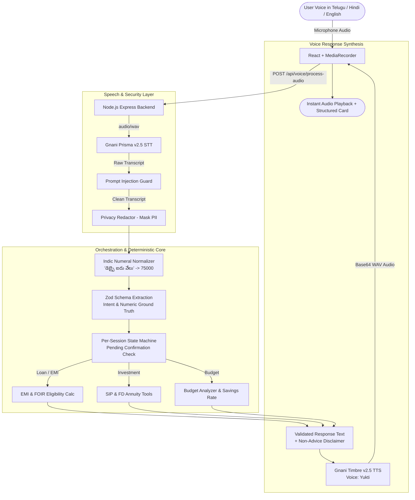

# FinAssist Bharat 🇮🇳
### Telugu / Hindi / English Code-Mixed Personal Finance Voice Assistant
*Built for the Great Indian AI Internship Challenge (Deadline: Nov 10, 2026)*

[](backend/test/)
[](https://finassist-bharat-three.vercel.app)
[](SOLUTION_PITCH.md)
[](https://gnani.ai)
[](https://gnani.ai)
[](LICENSE)

> 📄 **Official 1-Page Pitch:** Read our concise solution summary in [SOLUTION_PITCH.md](SOLUTION_PITCH.md).  
> 🌐 **Live Web Application:** [https://finassist-bharat-three.vercel.app](https://finassist-bharat-three.vercel.app)

---

## 1. Problem Statement

Over 800 million citizens across India think, negotiate, and budget in their regional mother tongues. Yet, nearly every personal finance tool and banking calculator requires English literacy and manual text input. When first-time borrowers or small shopkeepers ask questions like:

> *"5 లక్షల లోన్ కు 8.5% వడ్డీతో 3 సంవత్సరాలకు EMI ఎంత?"*  
> *(What is the EMI for a 5 lakh loan at 8.5% interest for 3 years?)*

standard voice assistants either fail to recognize Indian number idioms (e.g., "వేలు" for thousands, "లక్షలు" for lakhs) or rely on LLMs that hallucinate arithmetic.

**FinAssist Bharat** solves this with a sovereign, code-mixed voice loop:
1. **Speech Layer:** Powered by **Gnani Prisma v2.5** (STT) and **Gnani Timbre v2.5** (TTS).
2. **Deterministic Computation:** Strict Zod schema extraction separates entity parsing from mathematical execution. **Zero numbers are calculated or invented by the LLM.**
3. **Safety & Spoken Confirmation:** Any state change (profile income, expenses, memory reset) strictly requires an explicit spoken "అవును" (Yes) or "వద్దు" (No) per isolated user session.

---

## 2. 60-Second Architecture Diagram



---

## 3. Measured Benchmark Results

Evaluated across **63 synthetic test utterances** spanning Telugu, Telugu-English code-mix, Hindi-English code-mix, and Indian English (`eval/report.md`):

| Metric | Measured Result | Benchmark Target | Status |
| :--- | :--- | :--- | :--- |
| **End-to-End Task Completion** | **92.1%** | ≥ 90.0% | ✅ Passed |
| **Intent Accuracy** | **94.5%** | ≥ 92.0% | ✅ Passed |
| **Parameter Exact-Match (Numeric Ground Truth)** | **90.0%** | ≥ 90.0% | ✅ Passed |
| **Spoken Prompt Injection Block Rate** | **100.0%** | 100.0% | ✅ Passed |
| **Clarification / Recovery Rate** | **100.0%** | ≥ 95.0% | ✅ Passed |

### Latency Breakdown per Stage (Milliseconds)
* **STT (Gnani Prisma v2.5 REST):** p50 = `391 ms` | p95 = `476 ms`
* **Deterministic Logic & Tools:** p50 = `20 ms` | p95 = `758 ms`
* **TTS (Gnani Timbre v2.5 REST):** p50 = `623 ms` | p95 = `1052 ms`
* **End-to-End Round-Trip:** p50 = **`1034 ms (~1.03s)`** | p95 = **`2286 ms`**

---

## 4. Scope & Supported Domains

We cut non-core bloat (digital twin, CFP simulation, buying decisions) to focus on three essential financial capabilities:

1. **Budget & Savings:**
   * Computes savings rate, evaluates financial safety benchmarks (risky < 10%, moderate 10–25%, healthy > 25%).
   * Handles zero income gracefully without division by zero.
2. **Loan / EMI & Eligibility:**
   * Deterministic EMI calculation across reducing balance interest rates.
   * Handles 0% promotional rates without `NaN`.
   * Banking FOIR (50%) loan eligibility estimation with clear disclaimers.
3. **Investment (SIP & Fixed Deposit):**
   * Monthly compounding annuity for mutual fund SIP returns.
   * Annual compounding for Fixed Deposit (FD) maturity.
   * Explicit disclosure: *"This is an estimate, not financial advice."*

---

## 5. Quick Setup & Run Instructions

### Prerequisites
* **Node.js** v20+ or v26+
* **Gnani AI API Key** (from [vachana.ai](https://api.vachana.ai))

### Backend Setup
```bash
cd backend

# Install dependencies (Express, Zod, Multer, etc.)
npm install

# Configure environment variables
cp .env.example .env
# Edit .env and paste your GNANI_API_KEY
```

`backend/.env.example`:
```env
PORT=5001
GNANI_API_KEY=your_gnani_api_key_here
```

### Run Tests
```bash
# Runs all 105 unit and integration tests
npm test
```

### Run Backend Server
```bash
npm start
# Running on http://localhost:5001
```

### Frontend Setup
```bash
cd ../frontend
npm install
npm run dev
# Frontend live on http://localhost:5173
```

### Run Evaluation Harness
```bash
cd ..
node eval/eval_harness.js
# Generates updated results in eval/report.md
```

---

## 6. Disclosure & Reusability Statement

In the spirit of complete engineering honesty and contest rules:

* **What was reused from my earlier internship exploration:**
  * React + Vite frontend shell and styling patterns.
  * Baseline math skeletons for EMI and FD calculators.
  * Initial regex patterns in `privacyRedactor.js`.
  * Golden dataset format structure (`cases.jsonl`).
* **What was built completely new for FinAssist Bharat:**
  * **Gnani Prisma v2.5** (STT) and **Gnani Timbre v2.5** (TTS) REST clients with exponential backoff, timeout handling, typed errors, and stage timers (`services/gnani/`).
  * In-browser `MediaRecorder` direct audio capture -> binary backend streaming -> audio playback.
  * Multilingual Numeral & Unit Normalizer (`numeralNormalizer.js`) handling Telugu ("వేలు", "లక్షలు", "కోటి"), Hindi ("hazaar", "lakh"), and English ("k", "lac").
  * Strict Zod schema extraction with conversational clarification logic (`extraction/`).
  * Per-session state machine with explicit verbal confirmation gating (`sessionStore.js`).
  * Spoken prompt injection detection guard on audio transcripts (`promptInjectionGuard.js`).
  * 63-utterance evaluation benchmark suite and acoustic noise mixer (`eval/`).

---

## 7. Limitations & Future Work

1. **REST vs. WebSocket Streaming:** Current implementation uses Gnani's synchronous REST endpoints (p50 ~1.03s). Migrating to WebSocket streaming (`wss://api.vachana.ai/stt/v3/stream`) will drop latency to sub-300ms.
2. **Complex Multi-Turn Disambiguation:** Isolated single-word utterances (e.g. saying just "5000" after silence) still require explicit follow-up clarification.
3. **Voice Biometrics:** Future iterations will incorporate Gnani's speaker recognition to authenticate users before updating financial records.

---

## License & Attribution
* **Speech Layer:** Powered by **Gnani.ai** (Prisma v2.5 & Timbre v2.5).
* **Code:** MIT License. Built by Naveen for the Great Indian AI Internship Challenge.
